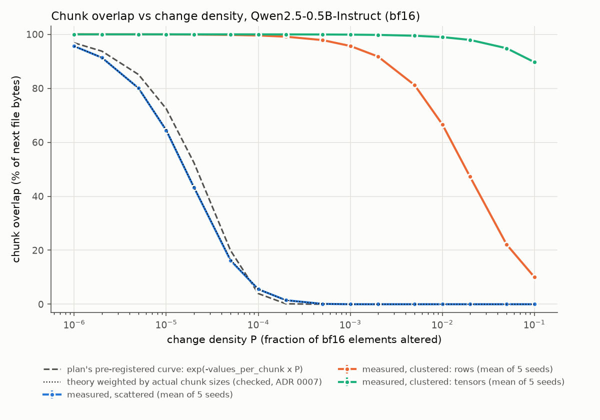
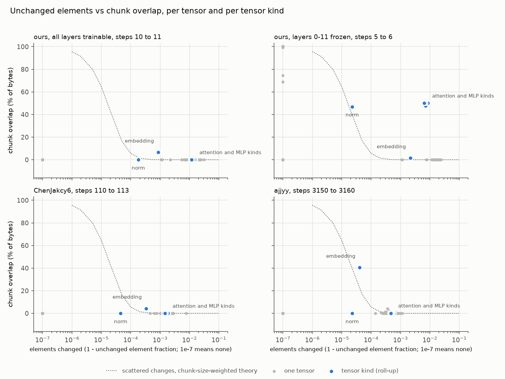

# Does Xet dedup consecutive RL checkpoints?

<!-- BEGIN answer -->
**No.** Across 46 checkpoint pairs, uploading the full next checkpoint transferred 63.0% to 99.8% of its size, which is 5.3x to 870.0x the blog's sparse delta for the same pair. Under the rule fixed before measuring (ADR 0001), the claim holds on 0 pairs, depends on 0, and does not hold on 46.

- On our own one-step-apart GRPO checkpoints (lr 1e-6, the blog's setup and its best case), a median 0.90% of elements change per step, yet only 1.9% of the bytes sit in chunks Xet can reuse.
- Freezing half the layers is the case where chunk dedup works: 36.6% of each checkpoint is reused, and the rest is still sent in full.
- The reason is arithmetic, not a defect: a chunk holds about 32,280 bf16 elements, so when 1% of elements change at random, 0.00% of bytes stay in reusable chunks (chart 1). Chunk dedup needs changes to cluster.
<!-- END answer -->

The sparse encoding in the delta-weight-sync blog is what makes per-step weight sync cheap. Xet's chunk dedup helps when changes cluster, as with frozen layers or embedding rows that do not change, and this repo measures how far each case gets.

## The claim

From [Shipping a Trillion Parameters With a Hub Bucket: Delta Weight Sync in TRL](https://huggingface.co/blog/delta-weight-sync) (2026-05-27), section 3.1:

> The practical upshot, which is delightful in this context, is that even if we were too lazy to write the sparse encoding and just uploaded full anchors every step, Xet would _still_ only transfer the changed chunks.

Read literally, this is true by construction: Xet sends the chunks that differ. This repo tests the reading a practitioner would act on, that uploading full checkpoints every step costs about as little as the blog's sparse deltas.

## Verdict rule

Fixed before measuring ([ADR 0001](docs/adr/0001-test-the-implied-claim-with-preset-thresholds.md)). For each checkpoint pair, compare the bytes Xet's upload path transfers for the next checkpoint with the sparse delta for the same pair (changed elements x 6 bytes: a 4-byte index plus a 2-byte bf16 value):

- transferred bytes within 3x of the sparse delta: **holds**;
- transferred bytes at least 50% of the anchor (the full checkpoint): **does not hold**;
- anything in between: **depends**, with the factor named.

## Results

### Per checkpoint pair (chart 3)

<!-- BEGIN pairs -->
| pair | step gap | anchor | elements changed | sparse delta | chunk overlap | transferred (share of anchor) | transferred / sparse delta | defrag gap | verdict |
| --- | ---: | ---: | ---: | ---: | ---: | ---: | ---: | ---: | --- |
| run-a (ours, all layers trainable), 21 consecutive pairs: median (min to max) | 1 | 988.1 MB | 0.90% (0.60% to 1.68%) | 26.8 MB (17.8 MB to 49.9 MB) | 1.9% (1.1% to 2.7%) | 98.7% (98.4% to 99.6%) | 36.6x (19.6x to 54.6x) | 0.64% (0.31% to 1.13%) | does not hold |
| run-a (ours, all layers trainable) steps 0 to 2 | 2 | 988.1 MB | 1.96% | 58.0 MB | 0.9% | 982.1 MB (99.4%) | 16.9x | 0.24% | does not hold |
| run-a (ours, all layers trainable) steps 10 to 12 | 2 | 988.1 MB | 1.52% | 45.0 MB | 1.2% | 982.4 MB (99.4%) | 21.8x | 0.58% | does not hold |
| run-a (ours, all layers trainable) steps 0 to 5 | 5 | 988.1 MB | 3.15% | 93.4 MB | 0.5% | 984.1 MB (99.6%) | 10.5x | 0.06% | does not hold |
| run-a (ours, all layers trainable) steps 10 to 15 | 5 | 988.1 MB | 2.78% | 82.5 MB | 0.9% | 982.2 MB (99.4%) | 11.9x | 0.18% | does not hold |
| run-a (ours, all layers trainable) steps 0 to 10 | 10 | 988.1 MB | 4.43% | 131.2 MB | 0.3% | 985.5 MB (99.7%) | 7.5x | 0.00% | does not hold |
| run-a (ours, all layers trainable) steps 10 to 20 | 10 | 988.1 MB | 4.07% | 120.6 MB | 0.6% | 983.4 MB (99.5%) | 8.2x | 0.06% | does not hold |
| run-a (ours, all layers trainable) steps 0 to 20 | 20 | 988.1 MB | 6.19% | 183.4 MB | 0.3% | 986.2 MB (99.8%) | 5.4x | 0.00% | does not hold |
| run-a (ours, all layers trainable) steps 1 to 21 | 20 | 988.1 MB | 6.28% | 186.1 MB | 0.3% | 986.3 MB (99.8%) | 5.3x | 0.00% | does not hold |
| run-b-frozen-half (ours, layers 0-11 frozen), 11 consecutive pairs: median (min to max) | 1 | 988.1 MB | 0.54% (0.48% to 0.85%) | 16.0 MB (14.4 MB to 25.3 MB) | 36.6% (36.5% to 37.5%) | 63.5% (63.0% to 63.5%) | 39.2x (24.6x to 43.7x) | 0.00% (0.00% to 0.40%) | does not hold |
| run-b-frozen-half (ours, layers 0-11 frozen) steps 0 to 2 | 2 | 988.1 MB | 0.97% | 28.6 MB | 36.9% | 624.5 MB (63.2%) | 21.8x | 0.09% | does not hold |
| run-b-frozen-half (ours, layers 0-11 frozen) steps 0 to 5 | 5 | 988.1 MB | 1.53% | 45.5 MB | 36.4% | 628.8 MB (63.6%) | 13.8x | 0.00% | does not hold |
| run-b-frozen-half (ours, layers 0-11 frozen) steps 0 to 10 | 10 | 988.1 MB | 2.21% | 65.4 MB | 36.3% | 630.0 MB (63.8%) | 9.6x | 0.00% | does not hold |
| run-b-frozen-half (ours, layers 0-11 frozen) steps 1 to 11 | 10 | 988.1 MB | 2.32% | 68.8 MB | 36.3% | 630.0 MB (63.8%) | 9.2x | 0.00% | does not hold |
| ajjyy/Qwen2-0.5B-GRPO-attempt1 steps 3150 to 3160 | 10 | 988.1 MB | 0.04% | 1.1 MB | 11.3% | 917.0 MB (92.8%) | 870.0x | 4.01% | does not hold |
| ChenJakcy6/Qwen2-0.5B-GRPO-test steps 110 to 113 | 3 | 988.1 MB | 0.12% | 3.5 MB | 1.2% | 983.5 MB (99.5%) | 282.2x | 0.65% | does not hold |
<!-- END pairs -->

"Chunk overlap" is the share of the next file's bytes in chunks whose hash also appears in the base. "Transferred" is `new_bytes + shard_bytes_uploaded` from Xet's own `DeduplicationMetrics` after uploading the base and then the next checkpoint to the same local store. The "defrag gap" is chunk overlap that the upload path re-sent anyway, because defrag prevention refused short matches.

<details>
<summary>Every pair measured</summary>

<!-- BEGIN all-pairs -->
| pair | step gap | anchor | elements changed | sparse delta | chunk overlap | transferred (share of anchor) | transferred / sparse delta | defrag gap | verdict |
| --- | ---: | ---: | ---: | ---: | ---: | ---: | ---: | ---: | --- |
| ChenJakcy6/Qwen2-0.5B-GRPO-test steps 110 to 113 | 3 | 988.1 MB | 0.12% | 3.5 MB | 1.2% | 983.5 MB (99.5%) | 282.2x | 0.65% | does not hold |
| ajjyy/Qwen2-0.5B-GRPO-attempt1 steps 3150 to 3160 | 10 | 988.1 MB | 0.04% | 1.1 MB | 11.3% | 917.0 MB (92.8%) | 870.0x | 4.01% | does not hold |
| run-a (ours, all layers trainable) steps 0 to 1 | 1 | 988.1 MB | 1.68% | 49.9 MB | 1.5% | 979.9 MB (99.2%) | 19.6x | 0.64% | does not hold |
| run-a (ours, all layers trainable) steps 0 to 2 | 2 | 988.1 MB | 1.96% | 58.0 MB | 0.9% | 982.1 MB (99.4%) | 16.9x | 0.24% | does not hold |
| run-a (ours, all layers trainable) steps 0 to 5 | 5 | 988.1 MB | 3.15% | 93.4 MB | 0.5% | 984.1 MB (99.6%) | 10.5x | 0.06% | does not hold |
| run-a (ours, all layers trainable) steps 0 to 10 | 10 | 988.1 MB | 4.43% | 131.2 MB | 0.3% | 985.5 MB (99.7%) | 7.5x | 0.00% | does not hold |
| run-a (ours, all layers trainable) steps 0 to 20 | 20 | 988.1 MB | 6.19% | 183.4 MB | 0.3% | 986.2 MB (99.8%) | 5.4x | 0.00% | does not hold |
| run-a (ours, all layers trainable) steps 1 to 2 | 1 | 988.1 MB | 1.39% | 41.2 MB | 1.1% | 983.7 MB (99.6%) | 23.9x | 0.61% | does not hold |
| run-a (ours, all layers trainable) steps 1 to 21 | 20 | 988.1 MB | 6.28% | 186.1 MB | 0.3% | 986.3 MB (99.8%) | 5.3x | 0.00% | does not hold |
| run-a (ours, all layers trainable) steps 2 to 3 | 1 | 988.1 MB | 1.25% | 37.2 MB | 1.3% | 978.9 MB (99.1%) | 26.3x | 0.32% | does not hold |
| run-a (ours, all layers trainable) steps 3 to 4 | 1 | 988.1 MB | 1.07% | 31.7 MB | 1.4% | 981.5 MB (99.3%) | 30.9x | 0.66% | does not hold |
| run-a (ours, all layers trainable) steps 4 to 5 | 1 | 988.1 MB | 1.32% | 39.0 MB | 1.3% | 983.3 MB (99.5%) | 25.2x | 0.78% | does not hold |
| run-a (ours, all layers trainable) steps 5 to 6 | 1 | 988.1 MB | 1.09% | 32.4 MB | 1.5% | 981.4 MB (99.3%) | 30.3x | 0.77% | does not hold |
| run-a (ours, all layers trainable) steps 6 to 7 | 1 | 988.1 MB | 0.99% | 29.2 MB | 1.8% | 975.5 MB (98.7%) | 33.4x | 0.43% | does not hold |
| run-a (ours, all layers trainable) steps 7 to 8 | 1 | 988.1 MB | 0.96% | 28.6 MB | 1.9% | 974.8 MB (98.7%) | 34.1x | 0.53% | does not hold |
| run-a (ours, all layers trainable) steps 8 to 9 | 1 | 988.1 MB | 0.99% | 29.3 MB | 2.1% | 972.5 MB (98.4%) | 33.2x | 0.43% | does not hold |
| run-a (ours, all layers trainable) steps 9 to 10 | 1 | 988.1 MB | 0.97% | 28.7 MB | 1.7% | 980.3 MB (99.2%) | 34.1x | 0.88% | does not hold |
| run-a (ours, all layers trainable) steps 10 to 11 | 1 | 988.1 MB | 0.90% | 26.8 MB | 1.8% | 980.4 MB (99.2%) | 36.6x | 0.93% | does not hold |
| run-a (ours, all layers trainable) steps 10 to 12 | 2 | 988.1 MB | 1.52% | 45.0 MB | 1.2% | 982.4 MB (99.4%) | 21.8x | 0.58% | does not hold |
| run-a (ours, all layers trainable) steps 10 to 15 | 5 | 988.1 MB | 2.78% | 82.5 MB | 0.9% | 982.2 MB (99.4%) | 11.9x | 0.18% | does not hold |
| run-a (ours, all layers trainable) steps 10 to 20 | 10 | 988.1 MB | 4.07% | 120.6 MB | 0.6% | 983.4 MB (99.5%) | 8.2x | 0.06% | does not hold |
| run-a (ours, all layers trainable) steps 11 to 12 | 1 | 988.1 MB | 0.84% | 24.8 MB | 1.9% | 975.7 MB (98.7%) | 39.4x | 0.58% | does not hold |
| run-a (ours, all layers trainable) steps 12 to 13 | 1 | 988.1 MB | 0.82% | 24.4 MB | 2.0% | 973.3 MB (98.5%) | 39.9x | 0.45% | does not hold |
| run-a (ours, all layers trainable) steps 13 to 14 | 1 | 988.1 MB | 0.76% | 22.5 MB | 2.2% | 972.5 MB (98.4%) | 43.2x | 0.60% | does not hold |
| run-a (ours, all layers trainable) steps 14 to 15 | 1 | 988.1 MB | 0.70% | 20.8 MB | 2.2% | 972.8 MB (98.4%) | 46.7x | 0.58% | does not hold |
| run-a (ours, all layers trainable) steps 15 to 16 | 1 | 988.1 MB | 0.65% | 19.3 MB | 2.6% | 974.3 MB (98.6%) | 50.6x | 1.13% | does not hold |
| run-a (ours, all layers trainable) steps 16 to 17 | 1 | 988.1 MB | 0.60% | 17.8 MB | 2.7% | 972.6 MB (98.4%) | 54.6x | 1.06% | does not hold |
| run-a (ours, all layers trainable) steps 17 to 18 | 1 | 988.1 MB | 0.67% | 19.9 MB | 2.4% | 973.6 MB (98.5%) | 48.9x | 0.89% | does not hold |
| run-a (ours, all layers trainable) steps 18 to 19 | 1 | 988.1 MB | 0.78% | 23.0 MB | 2.4% | 972.0 MB (98.4%) | 42.2x | 0.71% | does not hold |
| run-a (ours, all layers trainable) steps 19 to 20 | 1 | 988.1 MB | 0.81% | 24.1 MB | 2.3% | 972.7 MB (98.4%) | 40.4x | 0.69% | does not hold |
| run-a (ours, all layers trainable) steps 20 to 21 | 1 | 988.1 MB | 0.81% | 24.0 MB | 1.6% | 975.8 MB (98.8%) | 40.6x | 0.31% | does not hold |
| run-b-frozen-half (ours, layers 0-11 frozen) steps 0 to 1 | 1 | 988.1 MB | 0.85% | 25.3 MB | 37.5% | 622.4 MB (63.0%) | 24.6x | 0.40% | does not hold |
| run-b-frozen-half (ours, layers 0-11 frozen) steps 0 to 2 | 2 | 988.1 MB | 0.97% | 28.6 MB | 36.9% | 624.5 MB (63.2%) | 21.8x | 0.09% | does not hold |
| run-b-frozen-half (ours, layers 0-11 frozen) steps 0 to 5 | 5 | 988.1 MB | 1.53% | 45.5 MB | 36.4% | 628.8 MB (63.6%) | 13.8x | 0.00% | does not hold |
| run-b-frozen-half (ours, layers 0-11 frozen) steps 0 to 10 | 10 | 988.1 MB | 2.21% | 65.4 MB | 36.3% | 630.0 MB (63.8%) | 9.6x | 0.00% | does not hold |
| run-b-frozen-half (ours, layers 0-11 frozen) steps 1 to 2 | 1 | 988.1 MB | 0.69% | 20.5 MB | 37.2% | 624.0 MB (63.2%) | 30.4x | 0.26% | does not hold |
| run-b-frozen-half (ours, layers 0-11 frozen) steps 1 to 11 | 10 | 988.1 MB | 2.32% | 68.8 MB | 36.3% | 630.0 MB (63.8%) | 9.2x | 0.00% | does not hold |
| run-b-frozen-half (ours, layers 0-11 frozen) steps 2 to 3 | 1 | 988.1 MB | 0.63% | 18.7 MB | 37.3% | 623.1 MB (63.1%) | 33.4x | 0.29% | does not hold |
| run-b-frozen-half (ours, layers 0-11 frozen) steps 3 to 4 | 1 | 988.1 MB | 0.54% | 16.0 MB | 36.6% | 626.9 MB (63.4%) | 39.2x | 0.01% | does not hold |
| run-b-frozen-half (ours, layers 0-11 frozen) steps 4 to 5 | 1 | 988.1 MB | 0.65% | 19.1 MB | 36.6% | 626.6 MB (63.4%) | 32.8x | 0.00% | does not hold |
| run-b-frozen-half (ours, layers 0-11 frozen) steps 5 to 6 | 1 | 988.1 MB | 0.56% | 16.5 MB | 36.6% | 627.2 MB (63.5%) | 38.0x | 0.03% | does not hold |
| run-b-frozen-half (ours, layers 0-11 frozen) steps 6 to 7 | 1 | 988.1 MB | 0.52% | 15.3 MB | 36.6% | 627.0 MB (63.5%) | 41.0x | 0.00% | does not hold |
| run-b-frozen-half (ours, layers 0-11 frozen) steps 7 to 8 | 1 | 988.1 MB | 0.50% | 14.8 MB | 36.6% | 627.1 MB (63.5%) | 42.3x | 0.00% | does not hold |
| run-b-frozen-half (ours, layers 0-11 frozen) steps 8 to 9 | 1 | 988.1 MB | 0.50% | 14.9 MB | 36.5% | 627.6 MB (63.5%) | 42.2x | 0.00% | does not hold |
| run-b-frozen-half (ours, layers 0-11 frozen) steps 9 to 10 | 1 | 988.1 MB | 0.49% | 14.6 MB | 36.6% | 627.0 MB (63.5%) | 42.9x | 0.00% | does not hold |
| run-b-frozen-half (ours, layers 0-11 frozen) steps 10 to 11 | 1 | 988.1 MB | 0.48% | 14.4 MB | 36.6% | 627.2 MB (63.5%) | 43.7x | 0.00% | does not hold |
<!-- END all-pairs -->

</details>

### Where chunk dedup works: change density (chart 1)



Synthetic perturbations of `Qwen/Qwen2.5-0.5B-Instruct`: a fraction P of bf16 elements moved by one ulp, either scattered uniformly, or clustered into whole rows or whole tensors. Error bars are 3 standard errors over seeds.

<!-- BEGIN sweep -->
| | scattered | clustered: rows | clustered: tensors |
| --- | ---: | ---: | ---: |
| chunk overlap at density 1e-2 (about the blog's per-step rate) | 0.0% | 66.7% | 99.0% |
| chunk overlap at density 1e-4 | 5.6% | 99.6% | 100.0% |
| first density with overlap under 50% | 2e-05 | 0.02 | not reached by 0.1 |
| first density with overlap under 1% | 0.0005 | not reached by 0.1 | not reached by 0.1 |

Mean chunk 64,560 bytes, so 32,280 bf16 elements per chunk; 5 seeds per cell. The pre-registered curve `exp(-values_per_chunk x P)` misses the scattered points by up to 9.1 percentage points, and 4 of 16 scattered cells fall outside its fixed tolerance. The same chance weighted by the actual chunk sizes misses by at most 0.24 points (see Surprises).
<!-- END sweep -->

### Which tensors keep their chunks (chart 2)



Each grey dot is one tensor and each blue dot one tensor kind. Large tensors whose changes are scattered sit on the dotted theory line. Points far above it have clustered changes. Frozen tensors sit at the left edge with full overlap. The embedding in the ajjyy pair changes in few, contiguous rows and keeps a large share of its chunks. Small tensors, such as norms, can fall below the line, because they share chunks with their neighbours and the curve assumes a tensor spans many chunks.

### What the Hub stored for the third-party pairs

<!-- BEGIN hub -->
| pair | Hub: chunks of next file | Hub: chunks shared with base | Hub: bytes in shared terms | local: chunk overlap | local: dedup accepted by upload |
| --- | ---: | ---: | ---: | ---: | ---: |
| ChenJakcy6/Qwen2-0.5B-GRPO-test steps 110 to 113 | 15,336 | 202 (1.32%) | 0.48% | 1.19% | 0.54% |
| ajjyy/Qwen2-0.5B-GRPO-attempt1 steps 3150 to 3160 | 15,859 | 0 (0.00%) | 0.00% | 11.28% | 7.27% |
<!-- END hub -->

The Hub columns come from the CAS reconstruction API (`scripts/hub_reconstruction.py`): a chunk is shared when the next file's recipe points at the same xorb chunk as the base's. The ChenJakcy6 row reproduces the earlier research pass exactly, and the Hub's chunking of that file matches xet-core's (same Xet file hash). The ajjyy file was chunked by something else on the Hub (its Xet file hash differs from ours), and its recipe shows no dedup at all, so its Hub row is not comparable to the local measurement.

## Surprises

1. **The pre-registered theory curve misses the scattered sweep.** The plan fixed `exp(-values_per_chunk x P)`, with `values_per_chunk` the mean chunk size over 2 bytes, and a tolerance of 3 percentage points or 3 standard errors. At mid-range densities the scattered points fall outside it (see the sweep table). The cause is chunk-size variation: Xet chunks range from 8 KiB to 128 KiB, a chunk of `s` bytes survives with probability `(1-P)^(s/2)`, and the byte-weighted average of that is not its value at the mean size. Large chunks are both likelier to be hit and carry more bytes. The size-weighted curve matches every cell. The check is left failing as pre-registered, and `just e2e` reports it. Whether to replace the curve is the owner's call. The conclusion is the same under either curve, because both reach zero long before the per-step change rates measured here.
2. **The crates.io `hf-xet` 1.6.0 release over-reports dedup.** In that release, a dedup match that defrag prevention refuses is counted in `deduped_bytes` and then again as new data. So `deduped_bytes` overstates the dedup taken, and the reported file size exceeds the real one by exactly `defrag_prevented_dedup_bytes`. xet-core fixed this in #931, and every number here comes from xet-core at `d2f667c`, which includes the fix ([ADR 0006](docs/adr/0006-build-on-xet-core-at-d2f667c.md)). The fix changes only the accounting, not which chunks are sent: rerunning every pair on both versions gave byte-identical transferred bytes. `just e2e` asserts on every pair that the raw metrics now agree with what was sent ([ADR 0005](docs/adr/0005-measure-accepted-dedup-as-file-bytes-minus-new-bytes.md)).
3. **A header that changes length costs more than one chunk.** When no content-defined boundary appears within 128 KiB, the chunker cuts at exactly 128 KiB. A byte shift propagates through runs of such forced cuts, and bf16 checkpoints have many of them (`next_max_size_chunks` in `results/overlap-*.json`). Our pairs keep the same header length, so this does not affect them.

## Method

- **One Rust binary** (`ckpt-dedup`) on xet-core's `xet-data`, `xet-core-structures` and `hf-xet` crates at commit `d2f667c` ([ADR 0002](docs/adr/0002-rust-on-the-xet-crates-for-every-measurement.md), [ADR 0006](docs/adr/0006-build-on-xet-core-at-d2f667c.md)). That commit includes the dedup accounting fix that the crates.io 1.6.0 release lacks.
  - `overlap` chunks both files with `xet_data::deduplication::Chunker`, the chunker uploads use, and marks each chunk of the next file as reused or new. It credits each chunk's bytes to the header or the tensors its byte range covers, and compares the files element by element.
  - `upload` commits the base and then the next file to a fresh `local://` store through `XetSession` and reads `DeduplicationMetrics` ([ADR 0003](docs/adr/0003-local-store-only.md)).
  - `perturb` and `sweep` write and measure synthetic perturbations.
- **Checkpoints.**
  - Our own: Qwen2.5-0.5B-Instruct trained with TRL GRPO on CPU, AdamW, lr 1e-6 constant, weight decay 0, beta 0, an fp32 master copy, and a bf16 checkpoint after every optimizer step ([ADR 0004](docs/adr/0004-self-generated-best-case-checkpoints.md)). This is the blog's setup at its most favourable: the smallest learning rate and a step gap of 1. A second run freezes layers 0 to 11. Step 0 is byte-identical to the published checkpoint. The full config and library versions are in `data/manifest.toml`.
  - Third party: two public GRPO repos on the Hub, at the revisions in `data/manifest.toml`.
- **Checks that do not trust the tool.**
  - Our chunker reproduces the Xet spec's reference `.chunks` file byte for byte.
  - xet-core's own `chunk` example, followed by `sort` and `join`, gives exactly our whole-file chunk overlap.
  - numpy, with its own header parser, gives exactly our per-tensor unchanged element counts.
  - Property tests cover attribution, self-overlap, header rewrites and single-element changes.

## Limitations

- **A local store, not the Hub.** Within one pair, global dedup adds nothing, because the base's shard is already local. A real Hub upload also adds network and server behaviour that we do not measure.
- **Uncompressed transfer bytes.** `new_bytes` counts chunk bytes before compression. Xet compresses chunks (LZ4, byte grouping), so the bytes written to xorbs are lower (`xorb_bytes_uploaded` in `results/upload-*.json`). The sparse delta size is uncompressed as well, so both sides of the verdict are measured the same way.
- **Two small models and one learning rate.** Longer step gaps change more elements (see the step-gap rows), and PULSE reports that higher learning rates do too. Both push chunk overlap down, not up. We did not measure larger models.
- **Our own runs are tiny.** One prompt and four completions per step. That changes which elements move, but not the density regime the blog and PULSE report.
- **Generated checkpoints reproduce on this host.** CPU kernels are deterministic for a fixed thread count. Another host may produce different bytes, so `just fetch` verifies them but cannot download them.

## Future work

- **A real Hub upload of one pair to a private bucket**, to exercise the server, global dedup and shard registration. Skipped for offline reproducibility and the time budget ([ADR 0003](docs/adr/0003-local-store-only.md)).
- **A Hub reconstruction-API cross-check built into the tool**, to show what the Hub actually shares between public checkpoints without downloading them. For now `scripts/hub_reconstruction.py` does it for two pairs.
- **fp32 master-weight checkpoints**, and a higher learning rate (1e-5).
- **A one-sentence correction to the blog**, for example: "Xet dedups unchanged chunks, but at RL learning rates bf16 changes land in almost every chunk, so the sparse encoding is what makes this cheap." Discuss it with the blog authors first, rather than sending it cold.
- **The docs-drift fixes**, prepared but not opened: patches and a draft description for the hub-docs Xet environment table and xet-core's `HF_XET_LOG_FILE` references are in `docs/docs-drift/`.

## Reproduce

```bash
just fetch   # download and verify every Hub input in data/manifest.toml
just train --run run-a --steps 21 --seed 0
just train --run run-b-frozen-half --steps 11 --seed 0 --freeze-first-layers 12
just check   # inner loop: fmt, clippy, unit and property tests, golden chunker test, README staleness
just e2e     # outer loop: sweep, every pair, oracles and invariants (needs a xet-core clone, XET_CORE_DIR)
just report  # redraw charts and regenerate the tables in this README from results/
```

<!-- BEGIN provenance -->
Generated from 98 files in `results/`, produced by tool commit(s) ce32ad9 (0 from a dirty tree), on hf-xet 1.6.0+git.d2f667c, xet-client 1.6.0+git.d2f667c, xet-core-structures 1.6.0+git.d2f667c, xet-data 1.6.0+git.d2f667c, xet-runtime 1.6.0+git.d2f667c.
<!-- END provenance -->

Plan: [docs/plan.md](docs/plan.md). Lab notebook: [docs/run-log.md](docs/run-log.md). Glossary: [CONTEXT.md](CONTEXT.md).
