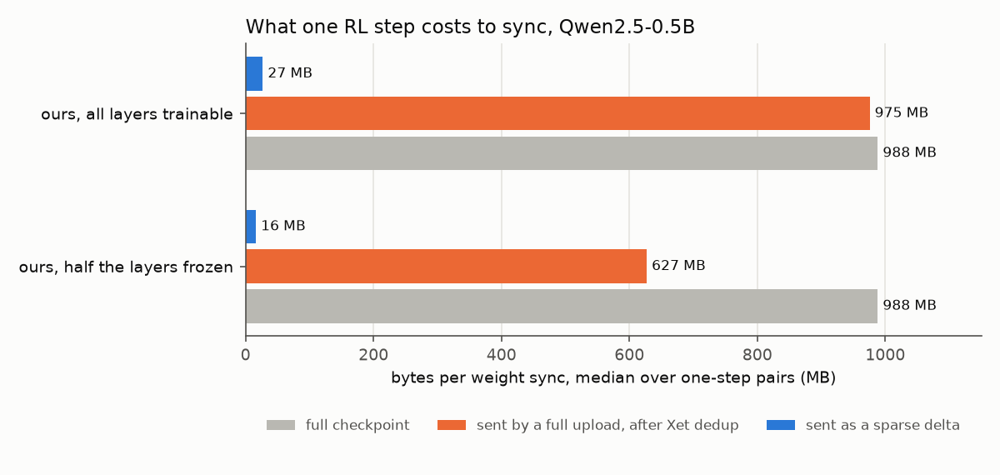
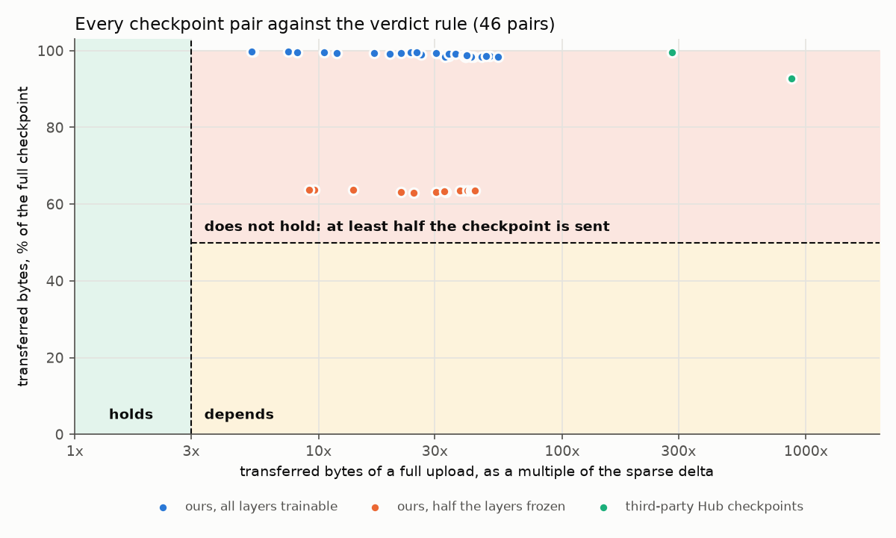

# How much does Xet dedup save when you sync full RL checkpoints?

## The question

Hugging Face's [delta-weight-sync blog](https://huggingface.co/blog/delta-weight-sync) (2026-05-27) is a neat piece of engineering. It syncs RL weights from the trainer to inference servers through a Hub bucket (S3-like storage on the Hugging Face Hub). Every step it sends only the bf16 elements that changed, a sparse delta, and every few steps a full checkpoint, an anchor. That cuts the per-step payload from gigabytes to tens of megabytes.

Buckets are backed by Xet, a content-defined chunking store that skips chunks it already holds, and the blog points out an appealing side effect:

> even if we were too lazy to write the sparse encoding and just uploaded full anchors every step, Xet would _still_ only transfer the changed chunks.

That sentence is exactly right: Xet only sends changed chunks. What it leaves open is how many chunks change when, as the blog reports, about 1% of elements move each step. If few do, storage dedup alone would make full-checkpoint sync nearly free, and much simpler to build. I wanted to know for sure, so I measured it with Xet's own Rust code, on our own GRPO run and on public checkpoints from the Hub.

## What I found

<!-- BEGIN value -->
If storage dedup alone made full uploads cheap, RL teams could skip the sparse encoding and let Xet do the work. That would be a big simplification, so it was worth measuring with Xet's own code. The answer: the blog's sparse encoding earns its place. On our own run, which uses the blog's setup at its most favourable, a full upload sends a median **975.5 MB per step** and the sparse delta **26.8 MB**, a median of **36.6x less** per weight sync. Over a 1,000-step run that projects to about 27 GB instead of 975 GB (median step x step count).

What this gives each audience:

- **RL teams syncing weights through a Hub bucket: confidence that the sparse path is worth its code.** Xet dedup does not stand in for it. TRL's pull requests for sparse sync ([#5417](https://github.com/huggingface/trl/pull/5417), [#5937](https://github.com/huggingface/trl/pull/5937)) were closed without merging on 2026-09-14, and these numbers make the case for landing that work.
- **Anyone keeping checkpoint history in a bucket: a realistic storage budget.** Enterprise buckets bill on deduplicated bytes, and each new checkpoint of our run adds a median 98.6% of its size as new chunks (counted before Xet's compression).
- **Xet and TRL maintainers: a map of where content-defined dedup shines.** It pays when whole regions stay bit-identical: with half the layers frozen, a median 36.6% of each checkpoint was reused. The work also turned up a dedup accounting bug in the released `hf-xet` 1.6.0. It is fixed in xet-core and waiting for a release.
<!-- END value -->



The chart shows our two runs. The third-party Hub pairs, whose sparse deltas are smaller still, are in [docs/results.md](docs/results.md).

## The numbers, pair by pair

<!-- BEGIN answer -->
**Xet dedup helps, and the sparse encoding does the heavy lifting.** Across 46 checkpoint pairs, a full upload transferred 63.0% to 99.8% of the checkpoint, which is 5.3x to 870.0x the sparse delta for the same pair. The bar we set before measuring (ADR 0001) was a full upload within 3x of the sparse delta: 0 pairs reached it, 0 landed in between, and 46 sent at least half the checkpoint.

- On our own one-step-apart GRPO checkpoints (lr 1e-6, the blog's setup and its best case), a median 0.90% of elements change per step, yet only 1.9% of the bytes sit in chunks Xet can reuse.
- Freezing half the layers shows Xet dedup at work: 36.6% of each checkpoint is reused for free, and the rest (the trained layers and the embedding) is sent again.
- The reason is arithmetic, not a flaw in Xet: a chunk holds about 32,280 bf16 elements, so when 1% of elements change at random, 0.00% of bytes stay in reusable chunks (see "Where chunk dedup works"). Chunk dedup needs changes to cluster.
<!-- END answer -->



Most of the all-trainable pairs overlap near the top of the chart. We fixed the bar before measuring, so the result could not move it ([ADR 0001](docs/adr/0001-test-the-implied-claim-with-preset-thresholds.md)). A pair counts as **holds** if the full upload sends at most 3x the sparse delta, which would be cheap enough to skip the sparse encoding. It counts as **does not hold** if the full upload sends at least half the checkpoint, so dedup saves less than half and the sparse encoding does the real work. Anything between is **depends**. "Holds" is tested first, so a pair under 3x counts as holding, whatever its share; no pair comes close. The transferred bytes here count chunks before compression, and so does the sparse delta. Every number behind the charts, pair by pair, is in [docs/results.md](docs/results.md).

## Where chunk dedup works


A Xet chunk is reused only if every byte in it is unchanged, and a chunk holds tens of thousands of bf16 elements. The sweep alters a fraction of a real checkpoint's elements by one ulp. When the changes are scattered, overlap is gone well before the change rates RL steps produce. When the same number of changes is packed into whole rows or whole tensors, most chunks survive. Error bars are 3 standard errors over 5 seeds. The dotted curve is the check the outer loop runs ([ADR 0007](docs/adr/0007-check-the-sweep-against-the-chunk-size-weighted-curve.md)).


Real checkpoints, tensor by tensor. Each grey dot is one tensor and each blue dot one tensor kind. Large tensors whose changes are scattered sit on the dotted theory line at zero. Frozen tensors sit at the left edge with full overlap. The embedding in the ajjyy pair changes in few, contiguous rows and keeps a large share of its chunks. Small tensors, such as norms, can fall below the line, because they share chunks with their neighbours and the curve assumes a tensor spans many chunks.

## Surprises

1. **The pre-registered theory curve was wrong, and was replaced after measuring.** The plan fixed `exp(-values_per_chunk x P)`, with `values_per_chunk` the mean chunk size over 2 bytes, and a tolerance of 3 percentage points or 3 standard errors. At mid-range densities the scattered points fell outside it (see the sweep in [docs/results.md](docs/results.md)). The cause is chunk-size variation: Xet chunks range from 8 KiB to 128 KiB, a chunk of `s` bytes survives with probability `(1-P)^(s/2)`, and the byte-weighted average of that is not its value at the mean size. Large chunks are both likelier to be hit and carry more bytes. The check now uses that byte-weighted average over the base's actual chunk sizes, with the same tolerance ([ADR 0007](docs/adr/0007-check-the-sweep-against-the-chunk-size-weighted-curve.md)). This curve was chosen after seeing the data. It has no free parameters, and a separate chunk-count prediction from the same model also matches. No verdict depends on either curve.
2. **The crates.io `hf-xet` 1.6.0 release over-reports dedup.** In that release, a dedup match that defrag prevention refuses is counted in `deduped_bytes` and then again as new data. So `deduped_bytes` overstates the dedup taken, and the reported file size exceeds the real one by exactly `defrag_prevented_dedup_bytes`. xet-core fixed this in #931, and every number here comes from xet-core at `d2f667c`, which includes the fix ([ADR 0006](docs/adr/0006-build-on-xet-core-at-d2f667c.md)). The fix changes only the accounting, not which chunks are sent: rerunning every pair on both versions gave byte-identical transferred bytes. `just e2e` asserts on every pair that the raw metrics now agree with what was sent ([ADR 0005](docs/adr/0005-measure-accepted-dedup-as-file-bytes-minus-new-bytes.md)).
3. **A header that changes length costs more than one chunk.** When no content-defined boundary appears within 128 KiB, the chunker cuts at exactly 128 KiB. A byte shift propagates through runs of such forced cuts, and bf16 checkpoints have many of them (`next_max_size_chunks` in `results/overlap-*.json`). Our pairs keep the same header length, so this does not affect them.

## Method

- **One Rust binary** (`ckpt-dedup`) on xet-core's `xet-data`, `xet-core-structures` and `hf-xet` crates at commit `d2f667c` ([ADR 0002](docs/adr/0002-rust-on-the-xet-crates-for-every-measurement.md), [ADR 0006](docs/adr/0006-build-on-xet-core-at-d2f667c.md)). That commit includes the dedup accounting fix that the crates.io 1.6.0 release lacks.
  - `overlap` chunks both files with `xet_data::deduplication::Chunker`, the chunker uploads use, and marks each chunk of the next file as reused or new. It credits each chunk's bytes to the header or the tensors its byte range covers, and compares the files element by element.
  - `upload` commits the base and then the next file to a fresh `local://` store through `XetSession` and reads `DeduplicationMetrics` ([ADR 0003](docs/adr/0003-local-store-only.md)).
  - `perturb` and `sweep` write and measure synthetic perturbations.
- **Checkpoints.**
  - Our own: Qwen2.5-0.5B-Instruct trained with TRL GRPO on CPU, AdamW, lr 1e-6 constant, weight decay 0, beta 0, an fp32 master copy, and a bf16 checkpoint after every optimizer step ([ADR 0004](docs/adr/0004-self-generated-best-case-checkpoints.md)). This is the blog's setup at its most favourable: the smallest learning rate and a step gap of 1. A second run freezes layers 0 to 11. Step 0 is byte-identical to the published checkpoint. The full config and library versions are in `data/manifest.toml`.
  - Third party: two public GRPO repos on the Hub, at the revisions in `data/manifest.toml`.
- **Checks that do not trust the tool.**
  - Our chunker reproduces the Xet spec's reference `.chunks` file byte for byte.
  - xet-core's own `chunk` example, followed by `sort` and `join`, gives exactly our whole-file chunk overlap.
  - numpy, with its own header parser, gives exactly our per-tensor unchanged element counts.
  - Property tests cover attribution, self-overlap, header rewrites and single-element changes.

## Limitations

- **A local store, not the Hub.** Within one pair, global dedup adds nothing, because the base's shard is already local. A real Hub upload also adds network and server behaviour that we do not measure.
- **Uncompressed transfer bytes.** `new_bytes` counts chunk bytes before compression. Xet compresses chunks (LZ4, byte grouping), so the bytes written to xorbs are lower (`xorb_bytes_uploaded` in `results/upload-*.json`). The sparse delta size is uncompressed as well, so both sides of the verdict are measured the same way.
- **Two small models and one learning rate.** Longer step gaps change more elements (see the step-gap rows), and PULSE reports that higher learning rates do too. Both push chunk overlap down, not up. We did not measure larger models.
- **Our own runs are tiny.** One prompt and four completions per step. That changes which elements move, but not the density regime the blog and PULSE report.
- **Generated checkpoints reproduce on this host.** CPU kernels are deterministic for a fixed thread count. Another host may produce different bytes, so `just fetch` verifies them but cannot download them.

## Future work

- **A real Hub upload of one pair to a private bucket**, to exercise the server, global dedup and shard registration. Skipped for offline reproducibility and the time budget ([ADR 0003](docs/adr/0003-local-store-only.md)).
- **A Hub reconstruction-API cross-check built into the tool**, to show what the Hub actually shares between public checkpoints without downloading them. For now `scripts/hub_reconstruction.py` does it for two pairs.
- **fp32 master-weight checkpoints**, and a higher learning rate (1e-5).
- **A one-sentence correction to the blog**, for example: "Xet dedups unchanged chunks, but at RL learning rates bf16 changes land in almost every chunk, so the sparse encoding is what makes this cheap." Discuss it with the blog authors first, rather than sending it cold.
- **The docs-drift fixes**, prepared but not opened: patches and a draft description for the hub-docs Xet environment table and xet-core's `HF_XET_LOG_FILE` references are in `docs/docs-drift/`.

## Reproduce

```bash
just fetch   # download and verify every Hub input in data/manifest.toml
just train --run run-a --steps 21 --seed 0
just train --run run-b-frozen-half --steps 11 --seed 0 --freeze-first-layers 12
just check   # inner loop: fmt, clippy, unit and property tests, golden chunker test, README staleness
just e2e     # outer loop: sweep, every pair, oracles and invariants (needs a xet-core clone, XET_CORE_DIR)
just report  # redraw charts and regenerate this README's summaries and docs/results.md from results/
```

<!-- BEGIN provenance -->
Generated from 98 files in `results/`, produced by tool commit(s) 1d82ec8 (0 from a dirty tree), on hf-xet 1.6.0+git.d2f667c, xet-client 1.6.0+git.d2f667c, xet-core-structures 1.6.0+git.d2f667c, xet-data 1.6.0+git.d2f667c, xet-runtime 1.6.0+git.d2f667c.
<!-- END provenance -->

Plan: [docs/plan.md](docs/plan.md). Lab notebook: [docs/run-log.md](docs/run-log.md). Glossary: [CONTEXT.md](CONTEXT.md).
